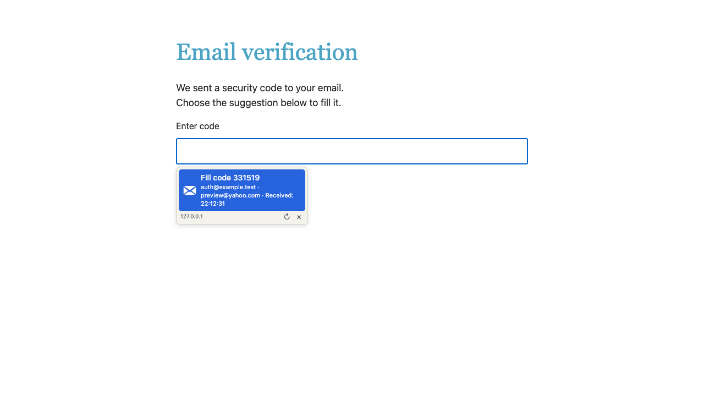

# Mail Verify

[](https://github.com/MrLawrenceAwe/Mail-Verify/actions/workflows/ci.yml)

Find verification codes and links for account confirmation, sign-in, and password resets in Yahoo inboxes from desktop Chrome on macOS. Select a result to fill the code or open the link. No webmail tab is needed. Yahoo is currently the only supported provider.



*Local preview with a synthetic email and verification code; no real inbox is accessed.*

The Chrome extension uses native messaging to request local email checks from a Python companion.

The local preview renders the real code suggestion interface with synthetic mail. Follow the [synthetic preview setup](docs/testing.md#synthetic-previews), then open the [local code preview](http://127.0.0.1:8767/docs/preview.html).

## Quick setup

Requires macOS, desktop Chrome, Python 3.9+ and a Yahoo-generated app password.

1. Run **Install Companion.command** from the project folder.
2. Load the `extension` folder through Chrome's **Load unpacked** control.
3. Pin Mail Verify, open its popup and add your Yahoo account.
4. Refresh any website tabs that were already open, request a verification email, then select the matching suggestion.

See [setup, updates and removal](docs/setup.md) and [the usage guide](docs/usage.md). Check the sender and destination before using a suggestion; this tool does not authenticate senders or match results to the current website.

## Privacy and permissions

Your Mac connects directly to `imap.mail.yahoo.com:993` over TLS. Credentials are stored in macOS Keychain under `local.yahoo_code_fill`, never in extension storage, configuration files, logs, or command-line arguments. Checks use a read-only inbox and `BODY.PEEK`, so they do not mark messages read.

The extension uses `nativeMessaging`, `activeTab`, and `scripting`, and runs a content script on HTTPS pages. On-page controls use an isolated content-script context and closed shadow roots. Results are held temporarily in memory. When you select a code to fill, the website can read that code. There are no analytics or AI integrations.

Chrome starts the companion on demand. No background login item, public server, or network listener is installed. Native messaging is restricted to this extension’s identity.

## Development and tests

Requires Node.js 22+ and Python 3.9+ for the automated checks:

```sh
npm test
```

CI runs both suites on macOS. Tests do not require Yahoo credentials or access Keychain. See [the developer guide](docs/development.md) for architecture and [testing and previews](docs/testing.md) for synthetic fixtures and checks requiring a real inbox.

## References

- [Chrome native messaging](https://developer.chrome.com/docs/extensions/develop/concepts/native-messaging)
- [Yahoo IMAP access](https://help.yahoo.com/kb/SLN28681.html)
